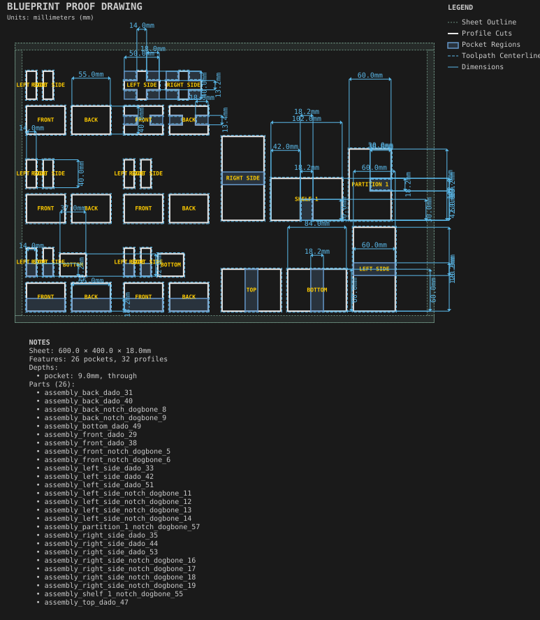
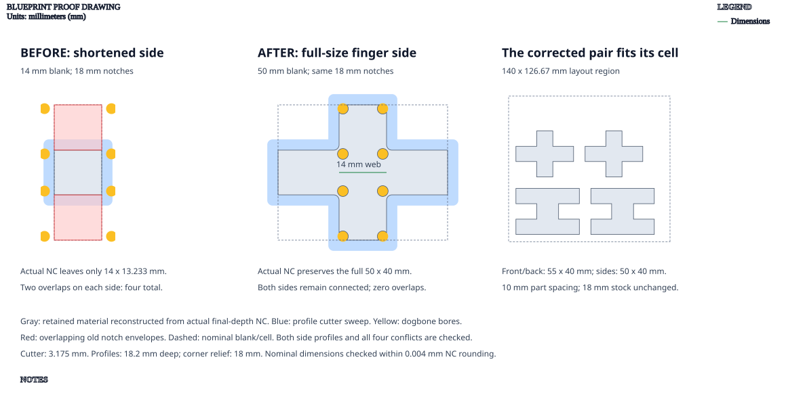

# Joinery test coupons

**Demonstrates:** Every joinery type as a small fit coupon.

## What gets cut

Offcut-sized coupons for each joinery type, cut before a big job to check fit and clearance on the machine.

The finger-jointed sample specifies a 55 × 50 × 40mm box in 18mm stock. Its
side profiles now retain their full 50 × 40mm dimensions. Previously, subtracting
the front/back thicknesses before cutting the fingers left only 14 × 13.233mm
side pieces and produced four notch-overlap reports. The box dimensions, notch
depths and clearance are unchanged; the corrected pieces fit their existing cell.

The proof checks both side profiles using the actual 3.175mm cutter, including
the through-profile and corner-relief programs, within 0.004mm NC rounding.

The captured-bottom and dado-bottom samples now use 37 × 32mm caps, reaching
their 9mm wall grooves. The [cap-fit proof](../../assemblies/box_bottoms_and_lids/cap-fit-proof.svg)
shows the same engagement rule on the 6mm box examples.

Sheet 600 × 400 × 18mm mdf.

- `pocket-12.70mm.nc`: pocket, 12.7mm tool, 12 feature(s), to 9mm
- `dogbone-3.17mm.nc`: dogbone, 3.175mm tool, 28 feature(s), to 18mm
- `dogbone-12.70mm.nc`: dogbone, 12.7mm tool, 48 feature(s), to 9mm
- `profile-3.17mm.nc`: profile, 3.175mm tool, 32 feature(s), to 18.2mm

## Run

`python -m cli.mill --recipe docs/recipes/shop/joinery_test_coupons`

## Outputs

- `dogbone-12.70mm.nc`
- `dogbone-3.17mm.nc`
- `joinery_test_coupons.svg`
- `machining_summary.json`
- `metrics.json`
- `pocket-12.70mm.nc`
- `profile-3.17mm.nc`
