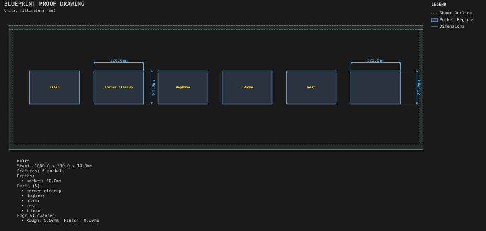

# Pocket corner test

**Demonstrates:** Pocket finishing options side by side: corner cleanup, dogbone, T-bone, rest pocketing and allowances.

## What gets cut

Identical 120 × 80 × 10mm pockets in a row, each finished a different way: plain, corner cleanup, dogbone, T-bone, rest pocketing, and rough-plus-finish allowance.

Sheet 1000 × 300 × 19mm mdf.

- `pocket-12.70mm.nc`: pocket, 12.7mm tool, 6 feature(s), to 10mm
- `pocket_rest-3.17mm.nc`: pocket_rest, 3.175mm tool, 1 feature(s), to 10mm
- `finish-12.70mm.nc`: finish, 12.7mm tool, 1 feature(s), to 10mm
- `corner_cleanup-3.17mm.nc`: corner_cleanup, 3.175mm tool, 4 feature(s), to 10mm
- `dogbone-12.70mm.nc`: dogbone, 12.7mm tool, 4 feature(s), to 10mm
- `dogbone-6.35mm.nc`: dogbone, 6.35mm tool, 4 feature(s), to 10mm

## Run

`python -m cli.mill --recipe docs/recipes/shop/pocket_corner_test`

## Outputs

- `corner_cleanup-3.17mm.nc`
- `dogbone-12.70mm.nc`
- `dogbone-6.35mm.nc`
- `finish-12.70mm.nc`
- `machining_summary.json`
- `metrics.json`
- `pocket-12.70mm.nc`
- `pocket_corner_test.svg`
- `pocket_rest-3.17mm.nc`
