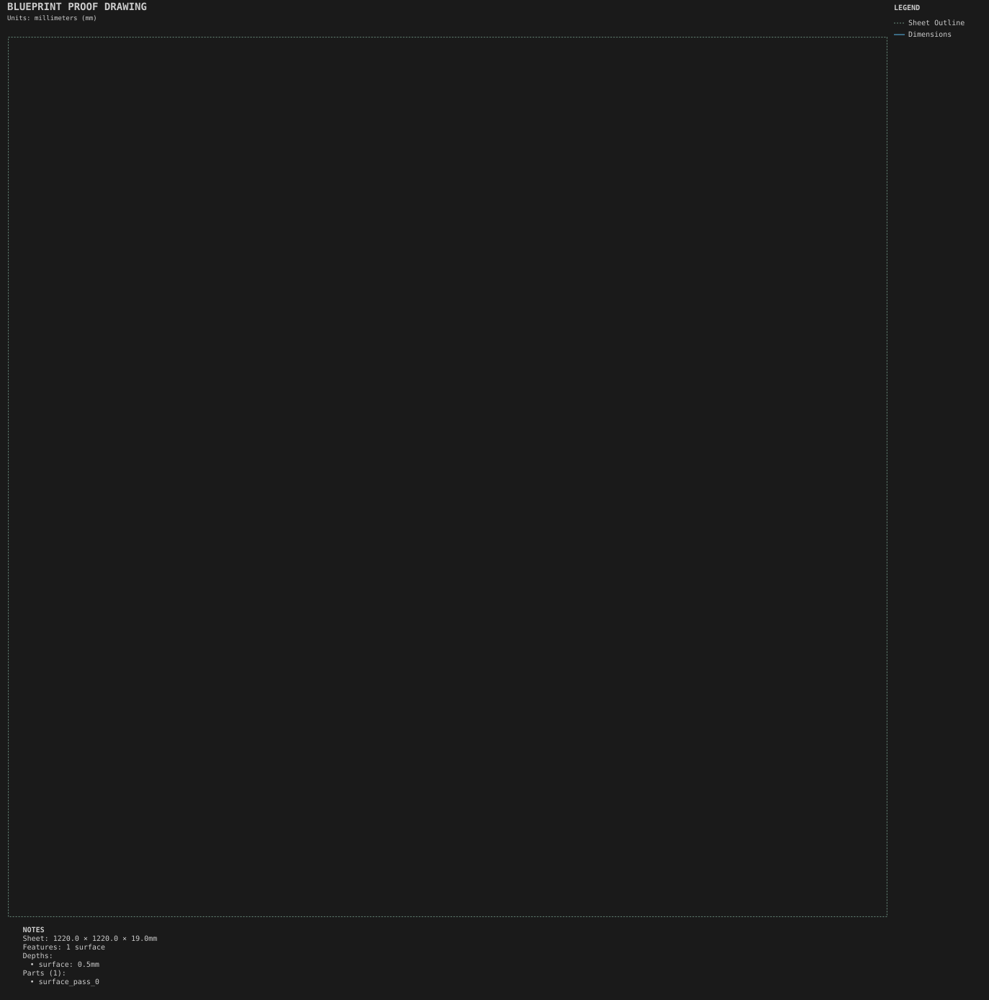

# Spoilboard surfacing

**Demonstrates:** Full-sheet facing with cooling retracts.

## What gets cut

A full-bed facing program for the spoilboard, with cooling retracts.

Sheet 1220 × 1220 × 19mm mdf.

- `surface-25.40mm.nc`: surface, 25.4mm tool, 1 feature(s), to 0.5mm

## Run

`python -m cli.mill --recipe docs/recipes/shop/spoilboard_surfacing`

## Outputs

- `machining_summary.json`
- `metrics.json`
- `spoilboard_surfacing.svg`
- `surface-25.40mm.nc`
